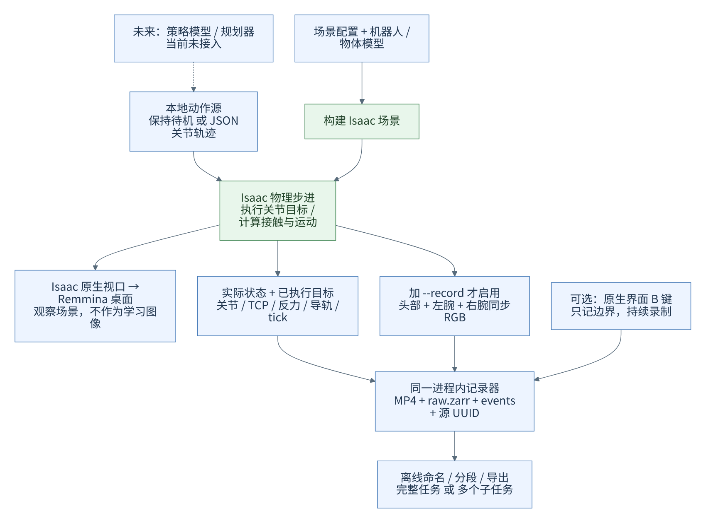

# 简化架构与无外部设备数据主干

更新：2026-10-14。日常入口为 `python -m bimanual_teleop.sim`，直接在 Remmina 桌面中打开 Isaac 原生场景。

## 为什么原来复杂，怎样简化

原方案同时涵盖本地输入、远程控制桥接、图像共享内存、浏览器全景和预览转发。它适合分布式遥操，却给只想看场景的操作增加了多个终端和端口。

现在默认路径为 **一个启动命令、一个 Isaac 进程**：源码与配置 → 容器启动 → 创建场景 → 物理与原生视图。`--record` 才创建三相机的渲染产品并启用记录器。

删除了 `scene_viewer.py`、`web/scene-viewer` 和 8081 转发入口；不再维护一份与 Isaac 平行的浏览器三维场景。`client/server/protocol` 保留为以后接设备的可选支路，不参与独立模式。模型转换、物理验证、原始记录、B 点与离线导出仍然需要保留。

## 无外部设备时的数据流



[PNG](diagrams/local-dataflow.png) · [Mermaid 源文件](diagrams/local-dataflow.mmd)

1. YAML、URDF、网格进入 `scene.py`，生成 Isaac 场景。
2. 动作源提供关节目标。目前实现保持待机与 JSON 关节轨迹；策略模型 / 规划器还没有接入此循环。
3. Isaac 施加目标、计算接触与运动，取得实际关节、TCP、反力、导轨状态和已执行目标。
4. 原生视图显示同一场景，Remmina 传送桌面画面。该桌面画面不作为学习相机图像。
5. 开启 `--record` 后，每八个物理步在不推进物理时间的条件下同步渲染头部、左腕、右腕 RGB；实际状态与图像一起交给同进程记录器。
6. 一次连续示范保存为三路 MP4、raw.zarr、events.jsonl、episode.json。B 在下一张成功记录的图像上确认无名称边界；暂停与恢复保留采样边界。
7. `segments.py` 离线命名范围，`export.py` 导出整任务、子任务或两者。

独立模式不经过 server、客户端、网络消息或共享内存图像环。录制器仍使用后台线程写盘，这是同一进程内的实现。

**没有外部设备并不意味着无需动作源。** 默认保持待机只能验证环境和记录链路；要完成取放任务，需提供有效轨迹或接入策略。保持待机的记录自动标为 synthetic，默认不能进入正常学习导出。

## 保留的核心文件

```text
sim/
├── __main__.py          单命令启动，自动处理主机 / 容器路径与桌面显示
├── engine.py            共用物理步进、实际状态读取、渲染与执行目标
├── scene.py             场景、机器人、碰撞、光照和三相机
├── local_session.py     独立动作、原生操作面板、B 点与可选记录器
├── actions.py           按仿真时间插值关节轨迹，检查顺序 / 限位 / 速度
├── kinematics.py        机器人运动学
├── assets.py            原始附件 → URDF / 网格 / 通孔碰撞体 / manifest
├── config.py, configs/  参数与覆盖配置
├── recording.py         原始三视频、状态、事件、UUID
├── segments.py, export.py  离线子任务与学习格式
├── task.py              当前导轨任务的完成指标
├── docker/              官方 Isaac 镜像与运行脚本
├── tests/, validate_isaac.py, smoke.py  验证
├── client.py, server.py, protocol.py, preview.py  可选外部设备分支
├── assets/              原模型与派生模型，忽略 Git
├── .runtime/            镜像、可写层、缓存，忽略 Git
└── data/                原始示范、方案、导出和检查报告，忽略 Git
```

## 新环境与新任务支持到哪里

| 改动 | 当前支持 | 需要做什么 |
| --- | --- | --- |
| 同一机器人，调整桌面、两个箱子、导轨台的位置 / 尺寸 | YAML 配置支持 | 复制配置并用 `--config` 启动，重新验收可达与碰撞 |
| 修改导轨尺寸 / 孔径、质量、摩擦、手安装角 | 支持参数修改 | 几何或安装角变化时重新 assets；重做物理检查 |
| 用关节轨迹执行不同动作 | 已有 JSON 轨迹入口 | 提供符合 54 关节顺序、限制、速度和起点的轨迹 |
| 增加新物体、换一种操作任务 | Isaac 可以承载，当前代码需扩展 | 修改场景构建及观测读取；新增相应动作和成功条件 |
| 移除导轨、换机器人、直接加载任意 USD 完整任务 | 尚不是现成入口 | engine 的导轨状态 / 接触、54 关节与 task 指标均有当前任务假设 |
| 自动规划抓取、调用策略模型闭环执行、批量并行训练环境 | 未实现 | 另接动作策略、任务 API、reset / success 及训练接口 |

因此，当前是**可复用的双臂仿真基础，加一个导轨任务实现**，不是零代码任务编辑器。不要只改任务名称就认为已经实现新任务。界面中临时编辑的 Stage 不会自动写回 YAML 或代码；重启以源码配置重新生成。

## 数据约定

14 个臂关节 + 40 个手关节，原始旋转为 XYZW，位置 m、角度 rad。末端为各肩部原点到法兰。六维数据为固定手安装关节反力，包含重力 / 惯性，未去皮。

导出 schema v2：三路 RGB、14D robot_joint、40D hand_joint、12D robot_eef_pose、12D wrench 和 52D action；末端旋转转为 rotvec。动作来自已执行目标。整任务窗口可跨 B；子任务在离线所选范围边界切开；真正暂停 / 缺帧两者都切开。同一原始示范的派生数据保留源 UUID，并统一划分训练 / 验证。

[从零搭建手册](zero-to-simulation.md) · [验证记录](validation.md)
