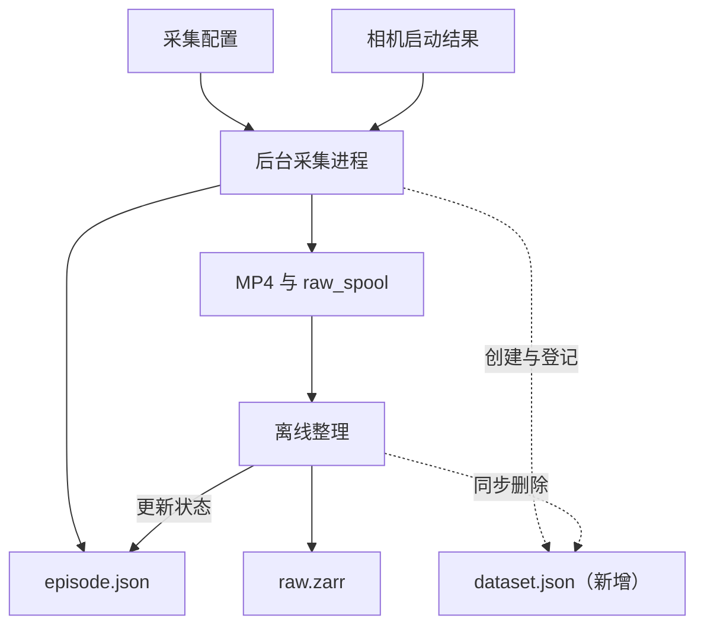

# Tianji 数据采集 dataset.json 方案

_实现说明 · 2026-10-11 · 基于已审阅的方案实现_

---

每个新采集 session 在首条开始创建时生成 `dataset.json`，集中描述任务、机器人、输入设备、相机角色和 episode 列表，供后续可视化、数据管理与格式导出使用。本文记录已实现的结构、更新行为和改动范围。

这里的“根目录”指一次采集输出的根目录，即 `output_dir/<session_id>/`。按照当前默认配置，对应项目下的 `recordings/<session_id>/`。第一版将一个 session 作为一个独立的数据集单元。

现有采集入口在启用 `--record` 时创建 Recorder，并传入 Tianji 和 Wuji 的配置快照。Recorder 每次启动生成一个 session，episode 编号在该 session 内递增，恢复采集进程后继续使用原有 session 和编号。在线阶段保存视频、原始 spool 和 episode manifest；离线整理后生成 `raw.zarr`。

| 现有代码 | 与方案相关的行为 |
| --- | --- |
| [采集入口](/Volumes/MobileSSD/Program/Tianji/bimanual-teleop/bimanual_teleop/cli/teleop_quest_tianji.py:113) | 加载采集配置，创建 Recorder，传入机器人和手部配置 |
| [Recorder](/Volumes/MobileSSD/Program/Tianji/bimanual-teleop/bimanual_teleop/recording/recorder.py:254) | 创建 session 标识，按顺序创建 episode |
| [CameraRig](/Volumes/MobileSSD/Program/Tianji/bimanual-teleop/bimanual_teleop/recording/camera.py:93) | 按序列号绑定相机，读取型号、内参和深度标定；根 manifest 中的语义角色来自采集配置 |
| [RawEpisodeWriter](/Volumes/MobileSSD/Program/Tianji/bimanual-teleop/bimanual_teleop/recording/spool.py:315) | 在线写入 `episode.json` 和原始 spool，成功收尾后标记为 `captured` |
| [离线整理](/Volumes/MobileSSD/Program/Tianji/bimanual-teleop/bimanual_teleop/recording/finalize.py:117) | 生成 `raw.zarr`，成功后标记为 `complete`，批量整理时删除作废条目 |

根 manifest 与采集流程的连接关系如下。虚线表示 manifest 更新操作。



以默认输出目录为例，布局为：

```text
recordings/<session_id>/
  dataset.json                   # 新增：session 元数据和 episode 索引
  episode_000000/
    episode.json                 # 本条状态、时间范围、计数和元数据快照
    camera_0.mp4
    camera_1.mp4
    camera_2.mp4
    raw_spool/                   # 在线采集生成
    raw.zarr/                    # 离线整理生成
  episode_000001/
    ...
```

以下 JSON 是结构示例。`dataset_id` 和 `created_at` 在运行时生成，示例时间不代表实际采集时间；相机序列号来自当前配置。

```json
{
  "schema_version": 1,
  "format": "tianji_raw_dataset",
  "dataset_id": "<session_id>",
  "created_at": "2026-10-11T12:00:00+08:00",
  "robot": {
    "name": "Tianji"
  },
  "task": "Pick and place the car seat rails",
  "cameras": {
    "camera_0": {
      "role": "overhead",
      "serial": "348122072137",
      "streams": ["rgb", "depth"]
    },
    "camera_1": {
      "role": "left_arm",
      "serial": "408322070938",
      "streams": ["rgb"]
    },
    "camera_2": {
      "role": "right_wrist",
      "serial": "408322072104",
      "streams": ["rgb"]
    }
  },
  "collection_devices": [
    {
      "model": "Wuji-glove",
      "role": "finger_motion_input",
      "sides": ["left", "right"]
    },
    {
      "model": "Quest-3s",
      "role": "wrist_pose_input",
      "components": [
        "headset",
        "left_controller",
        "right_controller"
      ],
      "sides": ["left", "right"]
    }
  ],
  "episodes": [
    {
      "episode_id": "episode_000000",
      "path": "episode_000000"
    },
    {
      "episode_id": "episode_000001",
      "path": "episode_000001"
    }
  ]
}
```

各字段采用下面的来源与约定：

| 字段 | 来源 | 约定 |
| --- | --- | --- |
| `schema_version` | manifest 模块 | 第一版为整数 `1`，只描述本文件的结构版本；与 episode、Zarr、LeRobot 的版本独立 |
| `format` | manifest 模块 | 固定为 `tianji_raw_dataset`，用于识别这类采集数据 |
| `dataset_id` | Recorder 的 session 标识 | 复用现有 session 目录名；移动或上传目录后保持不变 |
| `created_at` | 程序运行时 | 记录 session 创建时的实际时间，采用带时区的 ISO 8601 字符串；不使用 episode 的单调时钟时间戳充当日期 |
| `robot.name` | Tianji 采集入口 | 当前固定为 `Tianji` |
| `task` | 采集配置 | 当前默认配置填写 `Pick and place the car seat rails`；一个 session 对应一个任务 |
| `cameras` | 角色配置与 CameraRig 启动结果 | 使用稳定的 `camera_0`、`camera_1`、`camera_2` 键；序列号保留为字符串 |
| `collection_devices` | 采集配置 | 说明遥操作输入设备及用途；型号名称由配置声明 |
| `episodes` | 实际创建的 episode 目录 | 按编号排序，记录相对路径；同一 episode 只登记一次 |

相机角色默认映射为 `camera_0 → overhead`（顶部相机）、`camera_1 → left_arm`（左臂相机）、`camera_2 → right_wrist`（右臂腕部相机）。相机 1 按当前描述标为左臂相机。启用 `main_depth` 时，顶部相机的流为 `rgb` 和 `depth`；关闭后为 `rgb`。流列表由实际启用配置生成。

`collection_devices` 描述**遥操作输入来源**。Wuji-glove 提供手指动作输入，Quest-3s 及手柄提供用于腕部／机器人末端控制的位姿输入。目前 [RecorderSink](/Volumes/MobileSSD/Program/Tianji/bimanual-teleop/bimanual_teleop/recording/sink.py:203) 保存机器人关节反馈、力传感器数据和成功提交的控制目标，未保存完整的手套原始骨架流或 Quest 原始跟踪流。新增这些设备说明不会增加新的原始数据流。

两份 manifest 的信息分工如下：

| 文件 | 保存的信息 | 后续平台读取方式 |
| --- | --- | --- |
| `dataset.json` | session 标识、创建时间、机器人、任务、相机角色与序列号、输入设备、episode 列表 | 用于数据集发现、任务筛选、相机标签与 episode 导航 |
| `episode.json` | 本条状态、时间范围、各流计数、故障原因、实际相机标定和运行配置快照 | 用于条目状态、质量信息和实际采集参数展示 |

第一版保留现有 `episode.json` 的字段和配置快照。相机内外参及深度比例仍保存在每条 episode 中，以保留采集时的实际标定。`dataset.json` 的 episode 条目只记录标识与路径，状态、时长、帧数由平台读取 `episode.json` 后建立索引。两个 JSON 中不维护两套动态状态。

episode 的 `path` 相对于 `dataset.json` 所在目录，采用 `/` 分隔，不写入本机绝对路径。平台可用 `dataset_id + episode_id` 组合标识一条 episode。作废条目删除后保留编号空缺，其余条目不重新编号。

[recording.yaml](/Volumes/MobileSSD/Program/Tianji/bimanual-teleop/configs/recording.yaml:1) 中新增了 `dataset` 配置段。三台相机序列号继续只在原有 `cameras` 配置中维护，新增配置仅描述任务、角色和输入设备。配置片段如下：

```yaml
dataset:
  task: "Pick and place the car seat rails"
  camera_roles:
    camera_0: overhead
    camera_1: left_arm
    camera_2: right_wrist
  collection_devices:
    - model: Wuji-glove
      role: finger_motion_input
      sides: [left, right]
    - model: Quest-3s
      role: wrist_pose_input
      components: [headset, left_controller, right_controller]
      sides: [left, right]
```

[配置加载器](/Volumes/MobileSSD/Program/Tianji/bimanual-teleop/bimanual_teleop/recording/config.py) 校验任务句子非空、三路相机角色齐全、输入设备结构正确，并拒绝未知字段。序列号数量、唯一性和字符串校验继续沿用。旧采集配置省略 `dataset` 时使用当前默认任务、角色和设备说明；采集其他任务时须修改任务句子。

manifest 的更新只发生在采集生命周期节点，行为如下：

| 时机 | 更新行为 |
| --- | --- |
| 首条 episode 创建 | 相机启动验证通过后，由后台采集进程生成 `dataset.json`，并登记实际创建的 episode |
| 后续 episode 创建 | 根据 `episode_id` 幂等登记，保持编号顺序 |
| 保存或采集失败 | 当前状态仍写入 `episode.json`；已创建的条目保留在 dataset 列表中，便于查看和排查 |
| 暂停与继续 | 沿用同一 episode，无需新增列表条目 |
| C 恢复采集进程 | 保持原有 dataset 标识与元数据，核对现存 episode，补齐可能遗漏的登记 |
| 离线整理成功 | 更新 `episode.json` 的状态；dataset 列表中的标识和路径保持稳定 |
| 离线删除作废条目 | 实际删除目录后同步移除对应索引；目录尚未删除时仍保留条目 |

离线整理在处理完条目后统一核对各 session 的索引，支持以总目录、session 或单条 episode 为输入。索引写入失败会报告错误；重跑可修复，包括最后一条作废数据已经删除的空 session。已有 manifest 的 dataset 标识和创建时间保持不变，恢复时拒绝与原记录不一致的任务、相机角色、序列号、流配置或输入设备说明。

JSON 写入使用临时文件再替换目标文件，复用 [现有 write_json](/Volumes/MobileSSD/Program/Tianji/bimanual-teleop/bimanual_teleop/recording/storage.py:12) 的原子替换方式。在线更新由后台采集进程负责，离线整理在退出遥操作后执行。恢复时可根据各条 `episode.json` 核对列表，忽略隐藏的整理临时目录。

当前 [episode 发现逻辑](/Volumes/MobileSSD/Program/Tianji/bimanual-teleop/bimanual_teleop/recording/episodes.py:24) 递归查找 `episode.json`，新增根 manifest 可以作为附加信息。第一版保持现有整理、审片和转换的发现方式，旧数据仍可按现有逻辑读取。旧 session 的元数据回填可在后续需要时单独处理。

所有在线 manifest 写入安排在创建与恢复节点，由后台执行。深度逐帧写入、共享内存队列、时间戳处理和视频编码路径继续使用现有实现。

实现范围如下：

| 位置 | 调整 |
| --- | --- |
| [采集配置](/Volumes/MobileSSD/Program/Tianji/bimanual-teleop/configs/recording.yaml:1) | 新增 `dataset` 配置段，填写任务、角色和输入设备 |
| [配置解析](/Volumes/MobileSSD/Program/Tianji/bimanual-teleop/bimanual_teleop/recording/config.py:21) | 扩展配置结构、加载器和校验 |
| [dataset manifest 模块](/Volumes/MobileSSD/Program/Tianji/bimanual-teleop/bimanual_teleop/recording/dataset_manifest.py) | 统一生成、读取、登记、核对与原子写入逻辑 |
| [Recorder 后台流程](/Volumes/MobileSSD/Program/Tianji/bimanual-teleop/bimanual_teleop/recording/recorder.py:109) | 接入 manifest 创建和 episode 登记；恢复后核对列表 |
| [离线整理](/Volumes/MobileSSD/Program/Tianji/bimanual-teleop/bimanual_teleop/recording/finalize.py:262) | 删除作废目录后同步索引 |
| [操作文档](/Volumes/MobileSSD/Program/Tianji/bimanual-teleop/docs/recording_guide.md)与[格式参考](/Volumes/MobileSSD/Program/Tianji/bimanual-teleop/docs/recording_reference.md) | 补充新配置与目录说明 |
| 测试 | 覆盖配置校验、角色绑定、索引更新、恢复和兼容性 |

测试覆盖：三路相机角色和序列号对应正确；关闭深度后流列表随之变化；索引重复核对不产生重复条目；恢复后标识与旧条目保持稳定；失败条目保留；离线删除作废条目后索引同步；原子替换失败后可重试；移动 session 后相对路径可用；没有根 manifest 的旧数据仍可被发现。

第一版按一个 session 一个任务实施。以后需要在同一 session 中采集多个任务时，再增加 episode 级的任务覆盖字段。可视化平台基于这些文件建立自己的查询索引；后续 LeRobot 或 Diffusion Policy 导出可读取根元数据映射任务和相机角色，具体导出适配另行实现。
